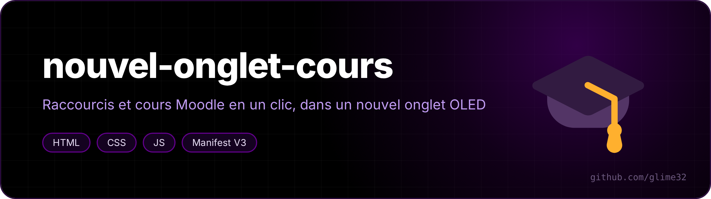
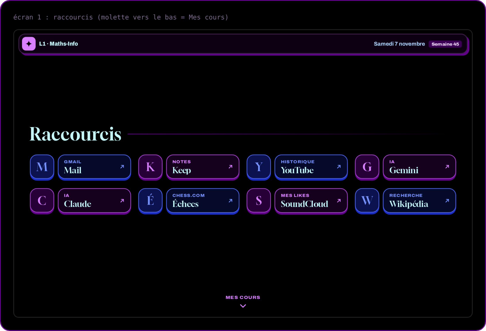
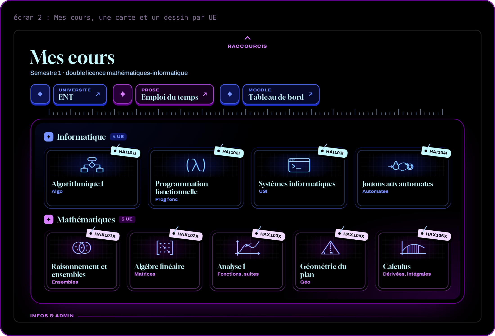

  

<a href="README.md">🇬🇧 English version</a>

**Une page « Nouvel onglet » pour étudiant : tes raccourcis en haut et, d'un coup de molette, tous les cours Moodle du semestre en cartes. Noir OLED, bleu et violet.**

Faite pour la double licence maths-info de l'Université de Montpellier, mais tout est dans un seul fichier, `cours.js` : change la liste des cours et elle est à toi.

## Fonctionnalités

- **Deux écrans** : les raccourcis, puis *Mes cours*. Molette, flèches du clavier ou glissement sur l'écran tactile pour passer de l'un à l'autre.
- **Une carte par UE**, avec son code sur une petite étiquette et un dessin (algorithme, lambda, terminal, automate, ensembles, matrice, courbe, triangle, intégrale). Un clic : le site charge tout de suite pendant que la carte s'agrandit. Ctrl+clic ou clic molette : nouvel onglet.
- **Date et numéro de semaine** dans la barre du haut.
- La barre d'adresse garde le curseur : tu peux toujours taper une recherche.
- Aucun script en arrière-plan, aucune requête réseau : les icônes viennent du cache local de Chromium, les polices sont incluses (Archivo et Gloock, licence OFL).

## Installation

1. Télécharge ce dépôt (*Code → Download ZIP*) et décompresse-le.
2. Ouvre `chrome://extensions` (ou `helium://extensions`) et active le *Mode développeur*.
3. *Charger l'extension non empaquetée* → choisis le dossier. Ouvre un nouvel onglet et clique *Conserver*.

## La personnaliser

Tout se passe dans `cours.js` :

- un cours Moodle : son `id` (le nombre après `?id=` dans l'adresse du cours), un titre, un nom court et un `dessin` ;
- un autre lien : `url` à la place de `id` ;
- le lien de ton emploi du temps Prose (il est personnel : celui d'ici renvoie à l'accueil).

Ensuite, ouvre un nouvel onglet. Si rien ne change, bouton ↻ sur la carte de l'extension.
