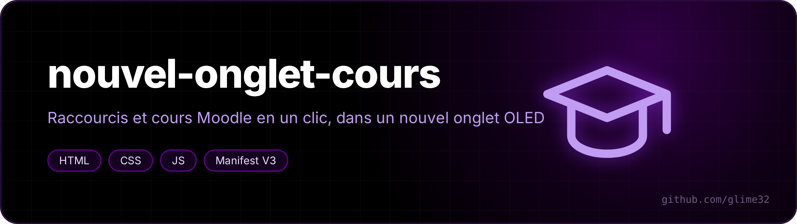
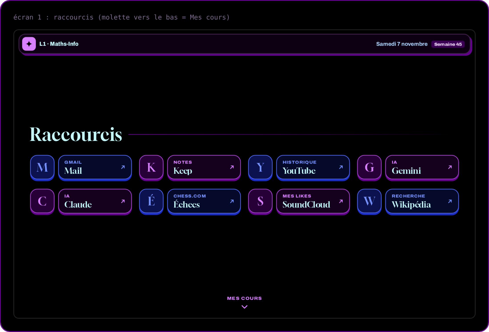
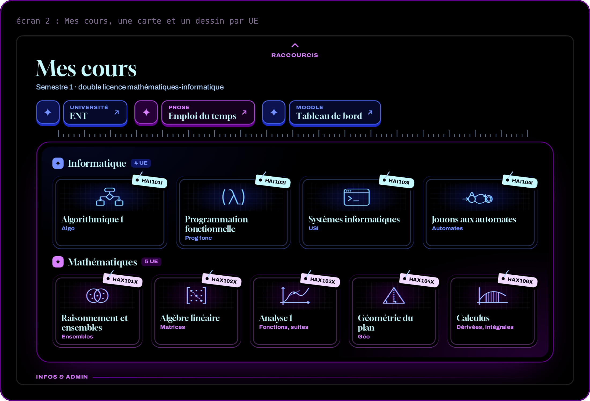

  

<a href="README.fr.md">🇫🇷 Version française</a>

**A new-tab page for students: your shortcuts on top, and one scroll down, every Moodle course of the semester as a card. OLED black, blue and purple.**

Made for the maths & computer science double degree at the University of Montpellier, but everything lives in one file, `cours.js`: change the course list and it's yours.

## Features

- **Two screens**: shortcuts, then *Mes cours*. Mouse wheel, arrow keys or a swipe on a touchscreen slide between them.
- **One card per course**, with its code on a little tag and a drawing (algorithm, lambda, terminal, automaton, sets, matrix, curve, triangle, integral). Click: the site loads right away while the card grows. Ctrl+click or middle-click opens a new tab.
- **Date and week number** in the top bar.
- The address bar keeps the focus: you can still type a search.
- Icons come from Chromium's local favicon cache, fonts are bundled (Archivo and Gloock, OFL).

## Study mode

A centered shortcut under the eight others, "Continuer": one click opens your revision site where you left off (its `#/continuer` address, as on [revisions-s1](https://github.com/glime32/revisions-s1)) in a "Révision" tab group, and starts a session of 4 × 25 min of work with 5 min breaks.

- While working, the sites in the `bloquer` list (YouTube, TikTok, Instagram by default) show "Pas maintenant" and come back by themselves during the break.
- The shortcut shows the time left; a "Arrêter" (stop) button appears next to it and needs a second click.
- On KDE Plasma, notifications are muted while working (Do Not Disturb) through a tiny C program, `hote/calme.c`. Install it with `sh hote/installer.sh`. Everything else works without it.

## University login and sessions

For the University of Montpellier (addresses in `manifest.json` and `fac-*.js`):

- **CAS**: put your username and password in `~/.config/fac/identifiants` (mode 600, created empty by `sh hote/installer.sh`). A tiny C program, `hote/identifiants.c`, hands them only to the real CAS page, which is filled and submitted at once, or to the background task. Without that file the extension waits for your password manager. Never after an error, at most once a minute.
- **Background login**: when CAS has forgotten you, the extension logs in again without showing any page, for Moodle and Prose. A refusal (wrong password, extra step) stops every automatic attempt for 24 hours and shows a notification.
- **Moodle**: the login page and any page seen "logged in as guest" go straight to CAS (`regles-fac.json`), which saves a 3 to 5 s detour, and a "Tout télécharger" (download all) button on every course that saves its files to `Téléchargements/Moodle-S1/<site>` (files already downloaded are skipped).
- **Sessions that last**: every 20 minutes, at browser startup and when you come back to the PC, if you used Moodle or Prose in the last 12 hours, the extension keeps the sessions alive in the background (Moodle's `core_session_touch`, which never creates a new session, so it is safe during an open quiz).
- If you also use [pdf-moodle-restore](https://github.com/glime32/pdf-moodle-restore), both extensions share the CAS click instead of submitting twice.

## Install

1. Download this repo (*Code → Download ZIP*) and unzip it.
2. Open `chrome://extensions` (or `helium://extensions`) and turn on *Developer mode*.
3. *Load unpacked* → pick the folder. Open a new tab and choose *Keep it*.

## Make it yours

Edit `cours.js` only:

- a Moodle course: its `id` (the number after `?id=` in the course URL), a title, a short name and a `dessin`;
- any other link: `url` instead of `id`;
- your Prose timetable link (it is personal, so the one here points to the home page);
- `revision`: your revision site's address, the block lengths and the list of sites to pause;
- `site` on a course: the folder name where "Tout télécharger" puts its files.

Then open a new tab. If nothing changes, press ↻ on the extension card.
